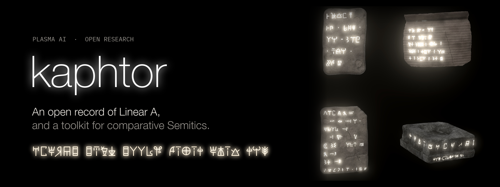

<h1 align="center">
  
</h1>

<p align="center">
  <a href="wiki/linear-a/inscriptions/_index.md"></a>
  <a href="wiki/linear-a/inscriptions/_index.md"></a>
  <a href="wiki/linear-a/words/_index.md"></a>
  <a href="wiki/linear-a/words/_index.md"></a>
  <a href="wiki/semitic-roots/_index.md"></a>
  <a href="wiki/linear-a/signs/_index.md"></a>
  <br>
  <a href="https://github.com/plasma-ai/kaphtor/actions/workflows/gate.yml"></a>
  <a href="LICENSE"></a>
  <a href="LICENSE-CC-BY-4.0"></a>
</p>

**An open record of Linear A, and a toolkit for comparative Semitics.** The name is Caphtor (כַּפְתּוֹר), the Hebrew
Bible's name for Crete.

kaphtor holds a reconciled record of the Linear A inscriptions, proposed readings for their words and signs, and tools
for testing those readings against the corpus. Beside it sit a database of Semitic roots and query tools for the
corpora of the ancient Near East.

Browse an inscription, trace a proposed reading to its evidence, or run the comparative tools on your own questions.
The datasets and tools work independently of the proposed decipherment.

The case for the readings is set out in [Opening Linear A](https://plasma.ai/research/linear-a) and in
[*Ya Diktu*](https://www.minoanmystery.org/linear-a/ya-diktu-grammar-tom-di-mino.pdf), the grammar of the peak
sanctuary libation formula.

> I opened this record so that anyone can test the decipherment, inscription by inscription and root by root. Every
> reading stands beside its evidence, its tier and its rivals. Break one, and the falsification goes on the record.
>
> —Tom di Mino

## Start here: the libation formula

The fullest copy of the peak sanctuary prayer runs in two lines around the four faces of a stone libation table from
Mount Iouktas, IO Za 2. Brackets mark the signs GORILA restores from the parallel copies.

> A-TA-I-\*301-WA-JA · JA-DI-KI-TU · JA-SA-SA-RA-\[ME\] · \[U-NA-KA-NA\]-SI · I-PI-NA-MA · SI-RU-TE ·
> TA-NA-RA-TE-U-TI-NU · I-DA-\[?\]
>
> *I make myself a dwelling—O Diqqitu!—in righteousness. So, behold my gathering in the presence of sacred song. May
> you be favorable toward us.*

[Read it word by word](wiki/linear-a/inscriptions/IO/IOZa/IOZa2.md): each word links to its reading, its tier and
every inscription where it recurs.

## Getting started

- **Read an inscription:** [IO Za 2](wiki/linear-a/inscriptions/IO/IOZa/IOZa2.md), or browse
  [all inscriptions](wiki/linear-a/inscriptions/_index.md) by site and GORILA series.
- **Look up a word:** [KU-RO, "total"](wiki/linear-a/words/K/KU_RO.md), or browse [all words](wiki/linear-a/words/_index.md)
  by first sign. The forms that open with an unvalued sign are under `star/`.
- **Look up a Semitic root:** [\*kanVs- "to gather, assemble"](wiki/semitic-roots/k/2763_to_gather_assemble.md), or
  browse [all roots](wiki/semitic-roots/_index.md) by first radical.
- **Learn how the corpus is organized:** [docs/anatomy.md](docs/anatomy.md).
- **Run a query:** [Run your first query](#run-your-first-query).
- **Contribute a reading, a rival analysis, a source or a correction:** [CONTRIBUTING.md](CONTRIBUTING.md).

## What's inside

| Part | What it holds | Browse |
|---|---|---|
| Inscriptions | One page per corpus record, with its transliteration, its Unicode text, its translation and a table linking each word | [inscriptions](wiki/linear-a/inscriptions/_index.md) |
| Words | One page per form, joining the lexicon, the onomasticon and the unread words, with every inscription where the form appears | [words](wiki/linear-a/words/_index.md) |
| Signs | The syllabic signs, logograms and fractions, each with its value and the evidence for it | [signs](wiki/linear-a/signs/_index.md) |
| Reading status | Every reading with its tier and score | `wiki/linear-a/standing.md` |
| Semitic roots | One page per root, with its reconstruction and its reflexes across the Semitic languages, each with its sources | [roots](wiki/semitic-roots/_index.md) |
| Eteocretan | The Eteocretan inscriptions and the analysis of their words | [Eteocretan](wiki/aegean/_index.md) |
| Corpus guides | What each ancient Near East corpus holds, its licence and its gaps, and how to query it | [guides](docs/corpora/_index.md) |

The pages are built from the [data](data/_index.md), where each dataset has a datasheet or manifest naming its
licence. [Repository guidance](docs/_index.md) covers how to read, contribute to and verify the record.

## Run your first query

The query tools need Python 3.11 or later and nothing else. The datasets are stored with Git LFS, so install
[Git LFS](https://git-lfs.com/) before cloning:

```sh
git lfs install
git clone https://github.com/plasma-ai/kaphtor.git
cd kaphtor
python3 tools/ane/query_place_authorities.py Knossos --authority pleiades --limit 3
```

This searches the Pleiades gazetteer in `data/ane/place-authorities/` and prints one place per line: the authority,
the place's id, its name and its Pleiades URL.

```
pleiades	238779098	Minoan Palatial Center (Knossos)	https://pleiades.stoa.org/places/238779098
pleiades	589872	Knosos/Col. Iulia Nobilis Cnosos	https://pleiades.stoa.org/places/589872
pleiades	229296321	Neolithic Settlement at Knossos	https://pleiades.stoa.org/places/229296321
```

Leave out `--authority` to search Pleiades and Trismegistos together, and add `--json` for the full records.
iDAI.gazetteer publishes no licence for its data, so it is queried live, one page at a time.
[tools/ane/README.md](tools/ane/README.md) lists the other query tools.

## How readings are graded

Every proposed reading carries a confidence tier, and moves up a tier only by passing that tier's test:

- **4, CONFIRMED:** passes all four corpus tests and is staked by the project's author, recorded on the reading's
  page as its reviewer. Where a scholar outside the project published the same reading first, most often Cyrus H.
  Gordon in *Evidence for the Minoan Language* (1966), the page also names that work and its sections.
- **3, PROBABLE:** passes the crossword and inscription tests, or shows complementary distribution between a full
  spelling and its abbreviation.
- **2, CANDIDATE:** attested in two or more independent contexts.
- **1, SPECULATIVE:** a proposal on record that has not yet met the CANDIDATE test.

No reading skips a tier. A rejected reading leaves the record for the archive, with the reason it was rejected.

> [!NOTE]
> These tiers describe support under this project's evaluation criteria. They do not imply scholarly consensus on the
> decipherment.

A sign value counts as resolved only on support that does not depend on a Semitic match: a Linear B value, a scribe's
arithmetic, or a spelling variant of the same word. Every other value is listed as proposed, with its evidence where
given. The record holds 38 sign values: 5 resolved (2 phonemic, 3 logograms) and 33 proposed (12 phonemic, 21
logograms). The fraction signs are counted apart: 3 resolved and 11 proposed.

Linear A has no proof kernel. Counts, distributions, arithmetic and reproducibility are checked mechanically.
Segmentation, sound correspondence and meaning stay graded and open to revision. When the three rival-language files
(the Luwian, Egyptian and Hurrian roots) are in the checkout, every Semitic match is rescored against them and,
where each rival gives a p-value, the margin is reported. Without them `root_match.py` stops and names the first
missing file, and under `--no-competitors` no word can reach `CONVERGENT`. [Confidence](docs/confidence.md) gives
the tests in full.

## Using the skills

The two skills in `skills/`, Linear A research and ancient Near East research, run the research from an agent session
in Claude Code or Codex. [skills/README.md](skills/README.md) describes what each skill does and the commands it runs.

In Claude Code, add this repository as a plugin marketplace, then install the plugin:

```
/plugin marketplace add plasma-ai/kaphtor
/plugin install kaphtor@plasma
```

The skills load when a request fits them. To call one by name, prefix it with the plugin:

```
/kaphtor:linear-a-decipherment Read IO Za 2 and list the rival readings of each word.
```

In Codex, link the two skill folders into `~/.agents/skills/` from your clone:

```sh
mkdir -p ~/.agents/skills
ln -s "$PWD/skills/linear-a-decipherment" "$PWD/skills/ancient-near-east-research" ~/.agents/skills/
```

Then mention a skill with `$`:

```
$linear-a-decipherment Read IO Za 2 and list the rival readings of each word.
```

## Development

<details>
<summary>Set up the environment, run the gate, and find your way around the repository.</summary>

The tooling requires [uv](https://docs.astral.sh/uv/) and Python 3.11 or later. All PDFs, every `.jsonl` data file
and the JSON data files over 1 MB are stored with Git LFS (the rules are in `.gitattributes`): in a clone made
before Git LFS was installed, run `git lfs install`, then `git lfs pull`.

From the repository root, set up the environment and the pre-commit hooks, then run the repository gate:

```sh
uv sync --all-groups
uv run --no-sync pre-commit install
uv run --no-sync kaphtor gate
```

The gate runs the tests, the pre-commit hooks, the index and licence checks, and the structure checks, and rebuilds
the generated pages, failing if they differ from what is committed. It only checks and changes no tracked file: it
runs the hooks' manual stage, where the whitespace fixers and `ruff --fix` that run at commit are replaced by checks.
GitHub Actions runs the same gate on every push and pull request.

The `ane` tools read local corpora. A corpus that cannot be redistributed is not in the repository, and its tool says
so and names the path it looked for; its corpus guide says where the corpus comes from. Set `KAPHTOR_DATA` to read
the data from another folder.

[AGENTS.md](AGENTS.md) gives the full check sequence and the conventions for agents.

### Repository layout

- `wiki/`: the record, generated from the data. Nothing in it is written by hand.
  - `linear-a/`: `inscriptions/<site>/<series>/`, `words/<initial>/` and `signs/{syllabic,logograms,fractions}/`,
    with the generated ledgers (`standing.md`, `counts.md`, `by_site.md`, `by_root.md`, `by_sign.md`)
  - `semitic-roots/`: one page per root, `<radical>/<id>_<slug>.md`
  - `aegean/`: `eteocretan/`
- `data/`: the datasets, each with a datasheet or manifest giving its licence and sources
  - `linear-a/`: the corpus, sign values, lexicon, onomasticon, translations, unread words, the Eteocretan sets and
    the rival-language root keys
  - `semitic-roots/`: the root database
  - `contact/`: the open contact lexica the root index links to the roots (Hebrew, Aramaic, Amarna Canaanite,
    Syriac, Akkadian)
  - `ane/`: open-licence ancient Near East datasets, such as the ORACC Akkadian literary glossary and PNM v6
  - `share-alike/`: CC BY-SA datasets, such as the ORAEC/TLA Egyptian texts and Trismegistos Geo, kept apart
- `docs/`: the repository's rules and methods, and the corpus guides, starting with [docs/anatomy.md](docs/anatomy.md)
- `assets/`: Noto Sans fonts for the Aegean scripts (OFL 1.1) and the README banner
- `tools/`: the Python package (`import tools`) behind the `kaphtor` command, described in
  [tools/README.md](tools/README.md)
  - `core/`: skeletons, morphology, phonetics, null models and the Shoresh root matcher
  - `linear_a/`: the Linear A tools (search, paradigms, accounting, sign tests)
  - `ane/`: query clients for the ancient Near East corpora
  - `views/`: the builder that writes `wiki/` from `data/`
- `skills/`: two agent skills, Linear A research and ancient Near East research, whose commands call `kaphtor`
- `tests/`: the tests for the tools, the data and the generated views

</details>

## Contributing

Readings, rival analyses, falsifications, sources, corrections and tools are welcome, from people or agents. Report a
misread sign or a failed reading as an issue: the templates cover a reading, a falsification, a rival hypothesis and a
rights concern. To submit a rival analysis or an addition, open a pull request following
[CONTRIBUTING.md](CONTRIBUTING.md), which covers copyright, page structure and the checks to run. A new reading enters
at tier 1 and rises only by passing the tests above.

## Citing

To cite this record, use [CITATION.cff](CITATION.cff). GitHub's "Cite this repository" button reads it.

## Acknowledgments

The corpus builds on Louis Godart and Jean-Pierre Olivier's *Recueil des inscriptions en linéaire A* (GORILA) and its
supplement RILA-S1, on [SigLA](https://sigla.phis.me), built by Ester Salgarella and Simon Castellan, and on Rob
Hogan's [lineara.xyz](https://github.com/mwenge/lineara.xyz). Its readings were checked against GORILA, John Younger's
*Linear A Texts* and the other primary editions, and many were corrected. GORILA's photographs and drawings are ©
École française d'Athènes and are not reproduced here.

The root database builds on the standard dictionaries of the Semitic languages, cited by siglum and page on every
cell, and the corpus guides credit each digital corpus the `ane` tools read.

## License

The code (`tools/`, `tests/` and `skills/`) is licensed under the [Apache License 2.0](LICENSE). Unless otherwise
noted, our original data and writing (`data/`, `wiki/`, `docs/` and the other documentation) are licensed under
[Creative Commons Attribution 4.0 International](LICENSE-CC-BY-4.0). Third-party material keeps its own terms, set
out below and in the `license` key of each datasheet:

- **Protected dictionaries.** The root database gives the cited form, the source's siglum and the page, so a reader
  can find the entry in the original. It reproduces no gloss or note from a closed source.
- **The Linear A corpus.** `data/linear-a/corpus.json` builds on SigLA, whose data is under CC BY-NC-SA 4.0, and on
  lineara.xyz, which states no licence. Our corrections and added layers are CC BY 4.0. The underlying texts keep
  their sources' terms. `data/linear-a/sigla-sign-map.json` is SigLA's sign list and stays under CC BY-NC-SA 4.0.
- **Share-alike data.** The files in `data/share-alike/` remain under CC BY-SA 4.0, and anything derived from them
  carries the same terms. Three more files under CC BY-SA 4.0 sit outside that folder, where the tools read them:
  `data/linear-a/egyptian_roots.json` and `luwian_roots.json`, which hold entries from Wiktionary, and
  `data/contact/syriac_lexicon.jsonl`, drawn from Wiktionary's Classical Syriac entries.
- **Rival-language keys and contact lexica.** The Egyptian, Luwian and Hurrian root files give each form, its key and
  its source labels, with no meaning. Most Luwian forms come from the Annotated Corpus of Luwian Texts and The
  Indo-European Database, which state no licence; `data/linear-a/rival-roots.md` sets out their terms. The contact
  lexica in `data/contact/` hold only rows and fields from open sources, among them ORACC's Amarna and CAMS/GKAB
  glossaries, which its open-data download releases under CC0; their datasheets name what the private build adds, why it is not here,
  and the known limits of each source.
- **The fonts.** The fonts in `assets/fonts/` are under the SIL Open Font License 1.1.
- **Withheld material.** Sources that cannot be redistributed are not shipped; the tools that read them name the path
  they looked for. Scanned books are not included.

Copyright © Tom di Mino. Published by Plasma AI.
