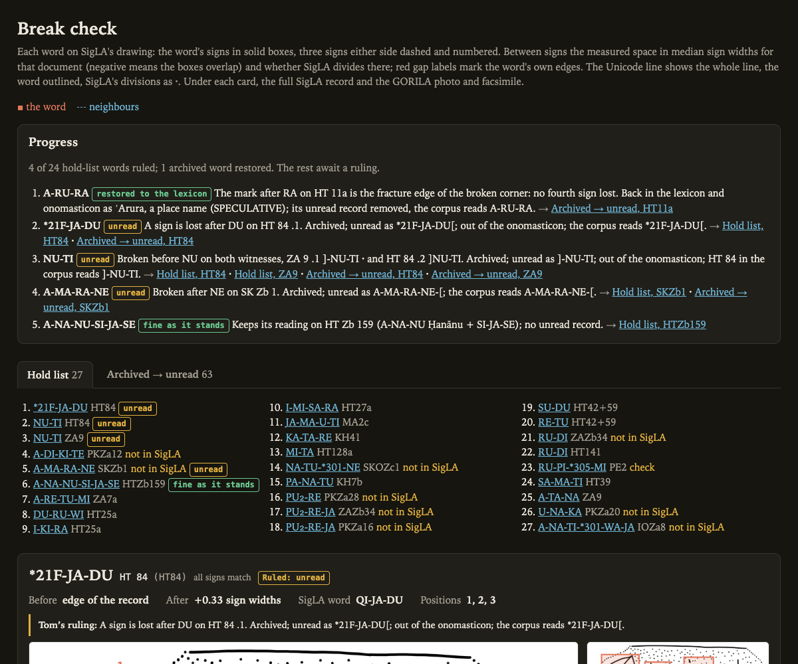
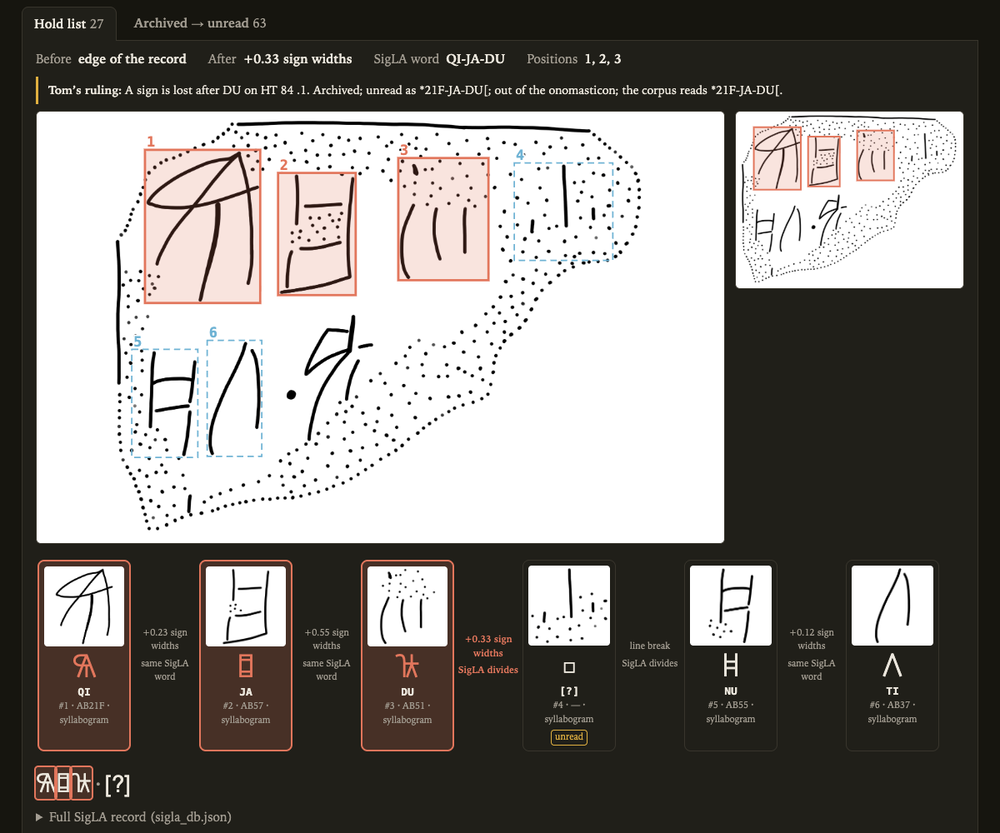
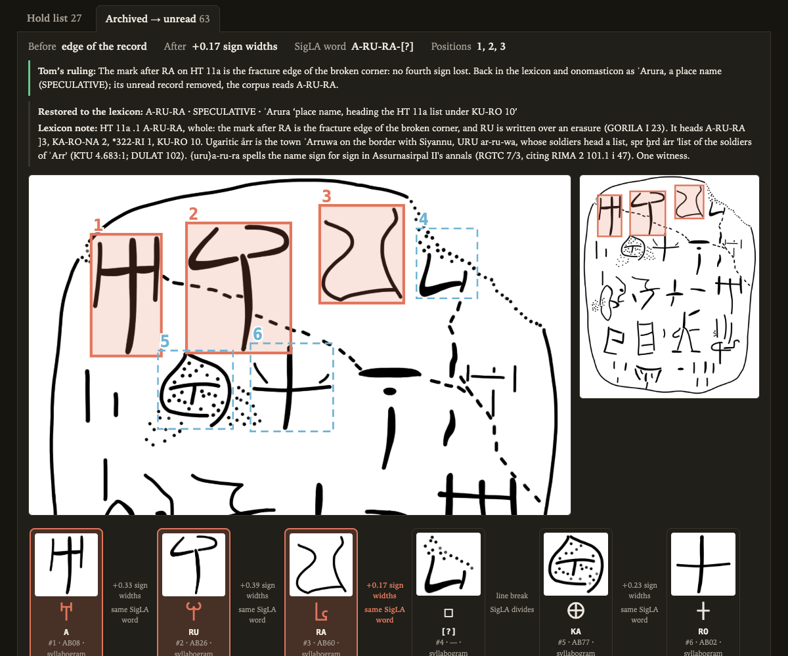

# Break check

[[docs/human-review/_index|..]]

The question: does a word end where the record says it does, or is a sign lost before or after it? A word whose
only witnesses are broken at an edge supports no reading, so the answer decides whether it stays in the lexicon
or is listed in `unread_words.json`.

## What a card shows

One card per attestation, on each SigLA face that holds the word:

- **The drawing.** SigLA's drawing of the document, zoomed on the word: its signs in solid boxes, three signs
  either side dashed and numbered by SigLA position; beside it the whole drawing with the word boxed.
- **The edges.** Before and after the word, the space to the next sign in median sign widths for that document
  (negative where the boxes overlap), a line break, or the edge of the record.
- **The strip.** Each position's SigLA crop, Unicode glyph, label, sign id and role, with its flags (unread,
  uncertain, erased, hidden, role doubted); between positions, the measured space and whether SigLA divides
  there, in red at the word's own edges.
- **The Unicode line.** Every line holding the word, the word outlined, SigLA's divisions as ·.
- **The SigLA record.** The whole `sigla_db.json` record, folded: metadata, SigLA's word division with the word
  marked, and every position with every field.
- **The match.** Whether every sign matches SigLA's reading; where SigLA reads the stretch otherwise; where a face
  holds only part of the word; where SigLA does not hold the document.
- **The edition.** The photograph and facsimile, folded, when `--edition-images` names a folder holding them.

A ruling recorded in the spec puts a badge on every card of the word and a line in the progress panel, linked to
its cards, so the page is also the ledger of what was decided.

## Building it

The spec is a JSON file naming the words and their corpus keys:

```json
{"title": "Break check",
 "tabs": [{"id": "hold", "title": "Hold list", "items": [{"word": "NU-TI", "keys": ["HT84", "ZA9"]}]}],
 "spans": {"RU-PI-*305-MI|PE2": [3, 9]},
 "rulings": {"NU-TI": {"outcome": "unread", "kind": "unread", "text": "Broken before NU on both witnesses."}}}
```

An item may carry `form`, the record's form where it differs from the word, and `notes`. `spans` boxes a stretch
SigLA reads otherwise, by its first and last SigLA position. A ruling's `kind` is `keep` or `unread`. A tab may
take its items from the source `archive_unread`, every archived lexicon entry with an unread record, which needs
a `lexicon_archive.json` beside the data.

```sh
uv run tools/linear_a/review/break_check.py docs/human-review/break-check.spec.json --fetch
uv run tools/linear_a/review/break_check.py SPEC.json --out DIR --crops CROPS --edition-images IMAGES
```

`--fetch` fetches SigLA's drawing of each document at one request a second; `--sigla-images` copies them from a
folder already holding them. `--crops` names a folder of SigLA sign crops (`{SigLA id}/{SigLA id}_{position}.png`),
`--edition-images` the root of the corpus records' `images` and `facsimileImages` paths. The page and its images go
to the user cache, `CACHE/review/{spec name}/`, or `--out`, which may not lie inside the repository. The page reads
the data and writes none of it.

## Worked example

`break-check.spec.json` is the hold list of a final review: 24 broken words that the lexicon read, 27
attestations. The reviewer judged each card; four rulings from it:

| Word | Ruling | What the card showed |
| --- | --- | --- |
| *21F-JA-DU | unread, *21F-JA-DU[ | HT 84 .1: SigLA sets an unread position after DU, and GORILA I 129 notes traces of a further sign |
| NU-TI | unread, ]-NU-TI | ZA 9 .1: a trace at the broken left edge and a divider after TI; HT 84 .2: GORILA's copie tabulaire sets ] before NU |
| A-MA-RA-NE | unread, A-MA-RA-NE-[ | SK Zb 1: NE damaged at the right-hand break, [ after it in both copies |
| A-NA-NU-SI-JA-SE | keeps its reading | HT Zb 159 |

A second tab, built from `archive_unread`, showed every archived word against its unread record. On its A-RU-RA
card the reviewer ruled the mark after RA on HT 11a the fracture edge of the broken corner, and the word returned
to the lexicon. GORILA I 22–23 and SigLA read a fourth sign there.







Screenshots: SigLA's drawings and sign crops (https://sigla.phis.me), © 2020– Ester Salgarella and Simon Castellan,
CC BY-NC-SA 4.0.
