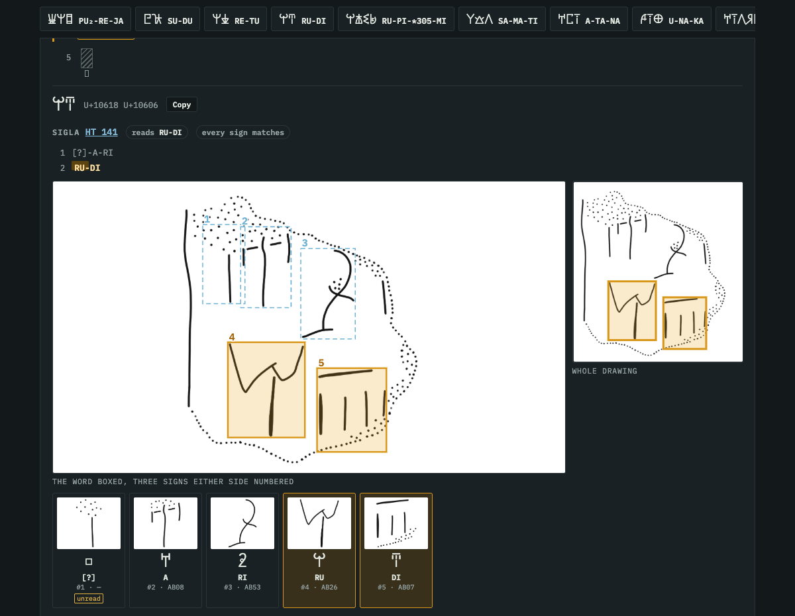
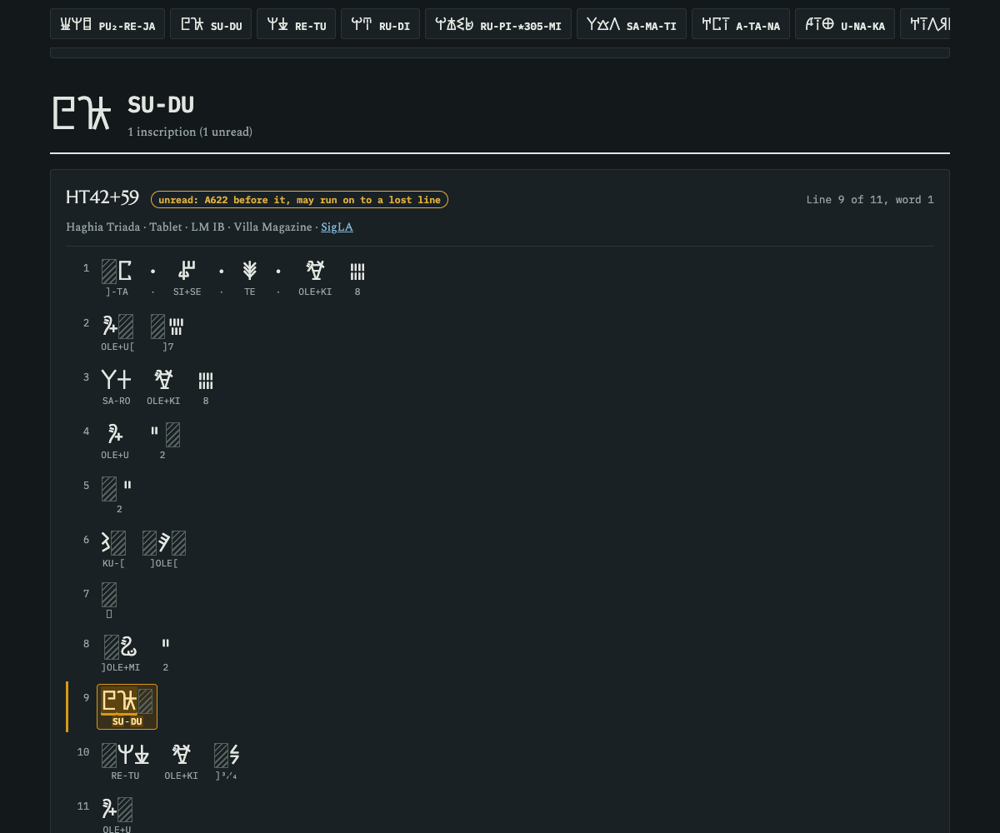

# Word in context

[[docs/human-review/_index|..]]

The question: how does a word stand in each inscription that carries it? Whole and bounded, broken at an edge, or
a stretch inside a longer word? The break check looks at one attestation's edges; this page sets every witness of
the word side by side.

## What a card shows

For each word, its Unicode, its count of inscriptions by kind, and its lexicon reading (or the reading of the
longer word it sits in). Then one card per inscription:

- **The tag.** The word itself, broken, or inside a longer word, read off the record's form; the spec can set a
  card's tag (`unread`, or `whole` with a note such as "more signs may follow").
- **The corpus text.** Every line of the inscription as Linear A glyphs over the transliteration, damaged or lost
  signs hatched, word dividers shown, the word's own signs lit, and its line and place on the line.
- **The Unicode.** The word's glyphs and code points, with a copy button.
- **SigLA.** SigLA's reading of the document line by line, the word lit; its drawing zoomed on the word with three
  signs either side numbered, and whole; each position's crop, glyph, label and flags; the full SigLA record.
- **The edition.** The photograph and facsimile, when `--edition-images` names a folder holding them.

## Building it

```json
{"title": "Nine Words in Context",
 "words": ["PU₂-RE-JA", "SU-DU", "RU-DI"],
 "ruled": {"SU-DU|HT42+59": ["unread", "unread: A622 before it, may run on to a lost line"]},
 "rulings": {}}
```

`ruled` sets one card's tag, keyed `WORD|corpus key`; `rulings` records a ruling on the word, as in the break
check.

```sh
uv run tools/linear_a/review/word_in_context.py docs/human-review/word-in-context.spec.json --fetch
```

The options and the output folder are the break check's.

## Worked example

`word-in-context.spec.json` sets nine words of a final review's hold list in their 20 inscriptions. The tags the
reviewer set:

| Word, inscription | Tag |
| --- | --- |
| PU₂-RE-JA, ZA Zb 34 | the word itself, PU₂ damaged |
| PU₂-RE-JA, PK Za 16 | the word itself, traces follow |
| RU-DI, HT 141 and ZA Zb 34 | the word itself, more signs may follow |
| SU-DU, HT 42+59 | unread: A622 before it, may run on to a lost line |
| RE-TU, HT 42+59 | unread: a word may be lost before it, A618 after |





Screenshots: SigLA's drawings and sign crops (https://sigla.phis.me), © 2020– Ester Salgarella and Simon Castellan,
CC BY-NC-SA 4.0.
