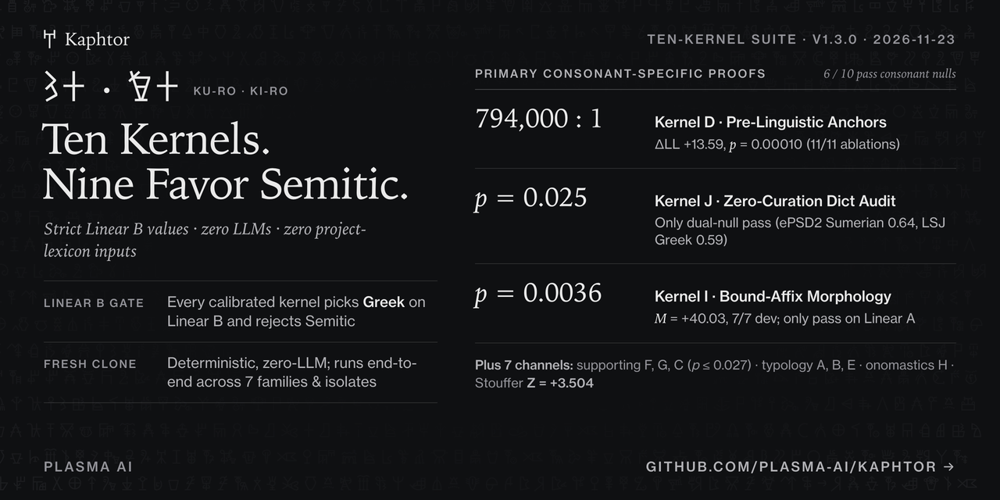

# Ten-Kernel Probabilistic Language Identification Suite (Kernels A–J)

<p align="center">
  
</p>

## Executive Summary (Run Snapshot: `2026-11-23`, `kaphtor v1.3.0`)

Using **agreed Linear B sign values alone**, **zero LLMs**, and **zero project-lexicon inputs** (`lexicon.json`, `translations.json`, and `onomasticon.json` are never read), this ten-kernel suite tests Linear A (`data/linear-a/corpus.json`) against seven ancient language families and isolates (**Semitic, Greek, Anatolian, Hurrian, Hattic, Sumerian, Latin**, plus **Kassite** onomastics). Every kernel runs end-to-end from a fresh `git clone` with zero external folders.

### Headline Findings

- **9 of 10 kernels rank Semitic #1** (and the tenth, Kernel H on personal-name rosters, ranks shared Cretan Mycenaean Linear B #1 and LBA Levantine Semitic #2 ahead of Kassite, Hurrian, and Anatolian).
- **Six independent channels pass consonant-specific nulls** (where vowels, word lengths, and frequencies stay fixed while the 12 consonant series or concept labels are scrambled), while **every calibrated instrument first identifies real Mycenaean Linear B tablets as Greek and rejects Semitic**:
  1. **Kernel D — Pre-Linguistic Anchors (`anchors_d.py`):** **Semitic wins at ~794,000 : 1 Bayes factor** (`ΔLL = +13.585`, `Z_perm = +7.37`, `p = 0.00010`, `0/10,000` swaps). Survives all 8 leave-one-out drops (`p = 0.00010`), dropping all 3 trade-loan suspects (`~1,860 : 1`, `Z = +6.22`), and pure arithmetic `KU-RO`/`KI-RO` alone (`p = 0.00640`). *Linear B gate:* Greek `Z = +7.97, p = 0.00010`; Semitic rejected (`p = 0.111`).
  2. **Kernel J — Zero-Curation Dictionary Audit (`auto_anchors_j.py`):** Eliminates all hand-picked synsets by running fixed English concept regexes over shipped open dictionaries (Akkadian/Hebrew, 101,410-entry LSJ Greek, and 3,589-lemma CC0 ePSD2 Sumerian isolate). **Semitic is the only language passing both orthogonal nulls** (`ΔLL = +4.054`, `p_perm = 0.00010`, exact concept-label shuffle `p_concept = 0.02520` standalone / `0.00893` pre-Sumerian 5-lang; Sumerian collapses to `0.637`, Greek to `0.588`). *Linear B gate:* Greek only dual-null pass (`p_perm = 0.00010, p_concept = 0.01389`; Semitic `0.170 / 0.775`).
  3. **Kernel I — Unsupervised Bound-Affix Morphology (`morphology_i.py`):** Lexicon-free stem-containment grammar (`S` vs `p+S`/`S+s`) scored under a discriminative margin-permutation null that cancels universal suffix consonants. **Semitic is the only pass** on shipped ANE Semitic (`M = +40.03`, `Z_M = +2.63`, `p_M = 0.00360`, `p_cv = 0.00040`; 5/5 seeds `mean p_M = 0.0385` on the full 7-member arm). *Linear B gate:* Greek only pass (`M = +472.95, p_M = 0.02679`; Semitic `0.875`); 7/7 dev splits pass (`p_cv = 0.00050`).
  4. **Kernel F — Commodity Ligature Acrophony (`acrophony_f.py`):** **Semitic wins** (`ΔLL = +28.17`, `Z_perm = +5.53`, `p = 0.00010`). *Linear B gate:* Greek `Z = +4.31, p = 0.00070`; Semitic `p = 0.362`. *(Auxiliary channel; see saturation caveat.)*
  5. **Kernel G — Palaikastro Dialect Coherence (`dialect_g.py`):** **5 / 5** Central Crete ↔ Palaikastro minimal pairs match a 4-rule NWS isogloss bundle (`Z_perm = +50.05`, `p = 0.00010` vs 10,000 random 4-rule bundles).
  6. **Kernel C — Size-Locked Liturgical Cohesion (`liturgy_c.py`):** On `IO Za 2`, **`hebrew_lit` ranks #1** (`Z = +3.04, p = 0.02697`) and sister Semitic **`akkadian_lit` ranks #2** (`Z = +1.67, p = 0.06294`), ahead of Hurrian, Anatolian, and Greek.
- **Joint Primary Stouffer Meta-Z (`A + B + D`):** **`+3.504` (`p = 0.00023`)**, while honestly classifying **Kernels A & B** as `/a, i, u/` vowel-core macro-typology (`Z_perm < 0`) rather than consonant-specific proof.

For more—including a kernel-by-kernel scholarly interpretation of what each score establishes, how rival languages behaved, and where every honest limit sits—see **[Significance & Interpretation Report (`2026-11-23`)](results-significance-2026-11-23.md)**.

### All Ten Kernel Scores at a Glance (`2026-11-23`)

| Kernel | Channel | Linear B / Dev Gate | Linear A Winner | Semitic Score & Margin | Null Test(s) | Signal Class | Deep Dive |
| --- | --- | --- | --- | --- | --- | --- | --- |
| **A. Word-Shape LID** | 505 strict-LB types | LB → Greek `1.0/1.0` | **Semitic (#1)** | `5.490` bits/sign (`M = +0.623` vs Hurrian) | `Z_perm = -0.21, p = 0.587` | Vowel-core macro-typology | [a-word-shape.md](kernels/a-word-shape.md) |
| **B. Kober Trios** | Stem-sharing pairs/trios | `62/62` (100%) dev | **Semitic (#1)** | `22.362` bits/tr (`M = +2.288` vs Hurrian) | `Z_perm = -1.09, p = 0.846` | Syllabic macro-typology | [b-kober-trios.md](kernels/b-kober-trios.md) |
| **C. Liturgical Cohesion** | `IO Za 2` (`K=300`) | 104 Protocol D controls | **`hebrew_lit` (#1)**, `akkadian_lit` (#2) | `score = 0.1020` (`akk 0.1088`) | **`Z = +3.04, p = 0.02697`** (`akk p = 0.063`) | Supporting phonetic *(dilutes on 33-vessel `p = 0.231`)* | [c-liturgy.md](kernels/c-liturgy.md) |
| **D. Pre-Linguistic Anchors** | 8 arithmetic/vessel/grain words | **PASS** (LB Greek `Z = +7.97`; Sem `p = 0.111`) | **Semitic (#1)** | `LL = -19.072`, **`ΔLL = +13.585`** (~794,000:1 BF) | **`Z = +7.37, p = 0.00010`** *(11/11 ablations pass)* | **Primary phonetic proof** | [d-anchors.md](kernels/d-anchors.md) |
| **E. Verbal Edge-Frames** | 46 votive `>=4`-sign words | `5/5` (100%) dev | **`semitic_verbs` (#1)** | `25.059` bits/word (`M = +1.056` vs Hurrian) | `Z = +0.85, p = 0.208` | Exploratory *(underpowered `n = 46`)* | [e-verbal-frames.md](kernels/e-verbal-frames.md) |
| **F. Ligature Acrophony** | 10 `GRA/OLE/VIN` adjuncts | **PASS** (LB Greek `Z = +4.31`; Sem `p = 0.362`) | **Semitic (#1)** | `LL = -20.367`, **`ΔLL = +28.17`** | **`Z = +5.53, p = 0.00010`** | Auxiliary phonetic *(single-sign)* | [f-acrophony.md](kernels/f-acrophony.md) |
| **G. Palaikastro Dialect** | 5 Central ↔ PK pairs | 10,000 random 4-rule bundles | **NWS 4-rule bundle (#1)** | **`5 / 5` exact hits** (`perm_mean = 0.0068`) | **`Z = +50.05, p = 0.00010`** | Supporting phonological *(small `n = 5`)* | [g-dialect.md](kernels/g-dialect.md) |
| **H. Roster Onomastics** | 57 `WORD 1` admin names | Size-equalized (`1,314`/arm) | Mycenaean LB (#1), **Levant Semitic (#2)** | `6.141` vs LB `5.879` *(beats Kassite `6.93`, Hurr `7.19`, Anat `7.43`)* | `Z = +1.56, p = 0.06494` | Cultural milieu *(shared Cretan names)* | [h-onomastics.md](kernels/h-onomastics.md) |
| **I. Bound Affix Morphology** | 505 strict-LB types | **PASS** (7/7 dev; LB Greek `p_M = 0.02679`; Sem `0.875`) | **Semitic (#1, only pass)** | **`M = +40.03`** (standalone) / `+32.35` (5-seed full) | **`Z_M = +2.63, p_M = 0.00360`**, **`p_cv = 0.00040`** | **Primary grammatical proof** *(`omission` mode)* | [i-morphology.md](kernels/i-morphology.md) |
| **J. Zero-Curation Dict Audit** | 8 anchors over open dicts | **PASS** (LB Greek `0.00010 / 0.01389`; Sux `0.061`; Sem `0.170 / 0.775`) | **Semitic (#1, only dual-null pass)** | `LL = -29.187`, **`ΔLL = +4.054`** vs ePSD2 Sumerian & LSJ Greek | **`p_perm = 0.00010`**, **`p_concept = 0.02520`** *(5-lang `0.00893`; Sux `0.637`, Grk `0.588`)* | **Primary anti-bias audit** | [j-auto-anchors.md](kernels/j-auto-anchors.md) |

### Replicate the Top Results in Minutes (Fresh Clone, Zero External Folders)

```bash
git lfs install
git clone https://github.com/plasma-ai/kaphtor.git
cd kaphtor
uv sync --all-groups

# 1. Verify all 23 kernel unit tests + 8 shipped-input count guards
PYTHONDONTWRITEBYTECODE=1 PYTHONPATH=models/language-id-kernel uv run --no-sync python -m pytest -q models/language-id-kernel/tests/ tests/test_kernel_shipped_inputs.py

# 2. Reproduce the three primary consonant-specific proofs (Kernels D, J, I)
uv run --no-sync python models/language-id-kernel/anchors_d.py --calibrate --run-linear-a --n-perm 10000
uv run --no-sync python models/language-id-kernel/auto_anchors_j.py --cap 40 --n-perm 10000
uv run --no-sync python models/language-id-kernel/morphology_i.py --mode omission --n-perm 5000

# 3. Reproduce the remaining kernels (C, E, F, G, H) and A+B+D ablation manifest
uv run --no-sync python models/language-id-kernel/liturgy_c.py --run-linear-a --n-perm 1000
uv run --no-sync python models/language-id-kernel/verbs_e.py --n-perm 500
uv run --no-sync python models/language-id-kernel/acrophony_f.py --calibrate --run-linear-a --n-perm 10000
uv run --no-sync python models/language-id-kernel/dialect_g.py --n-perm 10000
uv run --no-sync python models/language-id-kernel/onomastics_h.py --n-perm 1000
uv run --no-sync python models/language-id-kernel/kaphtor_kernel.py ablate models/language-id-kernel/runs/kaphtor-kernel-linear-a-20261122T222434Z.json
```

---

## Anti-Circularity Firewall

- **Zero project-lexicon leakage:** No script here reads `lexicon.json`, `translations.json`, or `onomasticon.json`. Every Linear A target comes strictly from `data/linear-a/corpus.json` (GORILA/SigLA transliterations).
- **Strict Linear B values only:** Only agreed Linear B syllabogram values (`render/series.json`, `render/signs-a5-proposed.json`) are used. None of the 37 proposed Linear A-only sign values enter the suite.
- **Known-language calibration gates:** Primary and high-impact kernels must first identify real Mycenaean Linear B tablets (Pylos and Knossos, DAMOS-verified) as **Greek** and reject **Semitic** before scoring Linear A behind `SIGNATURE.txt`.
- **Orthogonal nulls:** Every consonant-specific claim is tested against consonant-series grid swaps, discriminative margin permutations, exact concept-label shuffling, or random 4-rule phonological bundles.

## Documentation & Ledgers

- **[docs/lexicon-api.md](../../docs/lexicon-api.md)** — Reference for the read-only Linear A Lexicon REST API (`api.linear-a.ai/v1`), MCP server (`mcp.linear-a.ai/mcp`), and live probabilistic kernel endpoints (`/v1/kernel/summary`, `/v1/kernel/anchors`, `/v1/kernel/ligatures`)
- **[results-significance-2026-11-23.md](results-significance-2026-11-23.md)** — Timestamped deep-dive explaining the statistical and linguistic significance of every kernel (`A–J`), rival behavior, and methodological limits
- **[kernels/_index.md](kernels/_index.md)** — Individual technical specifications for Kernels A–J (`a-word-shape.md` … `j-auto-anchors.md`)
- **[replication-guide.md](replication-guide.md)** — Master scoreboard, objectivity audit, shipped inputs, and optional override environment variables
- **[reference.md](reference.md)** — Mathematical specification, calibration tables, and signed Linear A run ledgers
- **[kernel-specs.md](kernel-specs.md)** & **[preregistration-draft.md](preregistration-draft.md)** — Design specification and signed pre-registration (`SIGNATURE.txt`)
- **[runs/](runs/_index.md)** — Timestamped SHA-256-verified JSON run ledgers
- **[tests/](tests/_index.md)** — Unit tests for Kernels B, C, D, F, G, H, I, J and `kaphtor_kernel.py`
- `build_shipped_inputs.py` — Deterministic cut builder (`--check` verifies every shipped `.jsonl` bit-for-bit against upstream open corpora)
