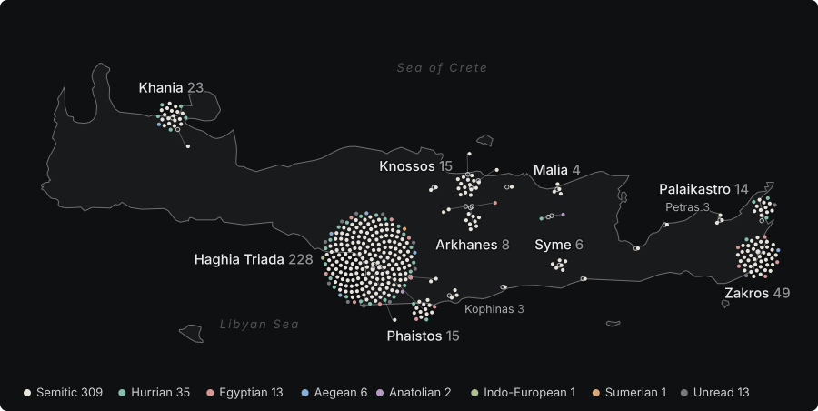

# Crete by find site

[[wiki/names/guide/_index|..]]

***

<!-- BEGIN kaphtor:record -->

Each name stands where its inscriptions were found. A dot is one name at one site, in the colour of its language layer, and a ring marks the site. A name found at two sites has a dot at each. Sites with one or two names are dots without a label; the table below names them.

## Sites on Crete

| Site | Names | Layers | Kinds | Most attested |
|---|---|---|---|---|
| Haghia Triada | 228 | Semitic 183, Hurrian 21, Unread 10, Egyptian 7, Aegean 4, Sumerian 1, Indo-European 1, Anatolian 1 | personal names 155, titles 35, place names 20, divine names 8, gentilics 6, place names or gentilics 4 | [[wiki/names/semitic/names/SA_RA2\|SA-RA₂]], [[wiki/names/semitic/names/A_DU\|A-DU]], [[wiki/names/semitic/names/I_RA2\|I-RA₂]], [[wiki/names/semitic/names/KU_PA3_NU\|KU-PA₃-NU]], [[wiki/names/semitic/names/DI_NA_U\|DI-NA-U]], [[wiki/names/semitic/names/KA_PA\|KA-PA]], [[wiki/names/semitic/names/MA_DI\|MA-DI]], [[wiki/names/semitic/names/SA_RU\|SA-RU]] and 220 more |
| Zakros | 49 | Semitic 41, Egyptian 5, Hurrian 1, Unread 1, Aegean 1 | personal names 32, titles 7, divine names 6, place names 2, gentilics 2 | [[wiki/names/semitic/names/I_DA\|I-DA]], [[wiki/names/semitic/names/A_SE\|A-SE]], [[wiki/names/egyptian/names/PA_JA_RE\|PA-JA-RE]], [[wiki/names/semitic/names/star28B_NU_MA_RE\|\*28B-NU-MA-RE]], [[wiki/names/semitic/names/A_RI_NI_TA\|A-RI-NI-TA]], [[wiki/names/semitic/names/DA_I_PI_TA\|DA-I-PI-TA]], [[wiki/names/semitic/names/MA_KA_I_TA\|MA-KA-I-TA]], [[wiki/names/semitic/names/SI_TE\|SI-TE]] and 41 more |
| Khania | 23 | Semitic 17, Hurrian 5, Aegean 1 | personal names 15, place names 3, titles 3, divine names 1, gentilics 1 | [[wiki/names/semitic/names/A_DU\|A-DU]], [[wiki/names/semitic/names/PI_SA\|PI-SA]], [[wiki/names/semitic/names/A_DA_star21F_RI\|A-DA-\*21F-RI]], [[wiki/names/semitic/names/A_DA_KI_SI_KA\|A-DA-KI-SI-KA]], [[wiki/names/hurrian/names/A_KI_PI_E_TE\|A-KI-PI-E-TE]], [[wiki/names/semitic/names/A_MA_JA\|A-MA-JA]], [[wiki/names/semitic/names/A_RA_U_DA\|A-RA-U-DA]], [[wiki/names/semitic/names/A_SI_KI_RA\|A-SI-KI-RA]] and 15 more |
| Knossos | 15 | Semitic 15 | personal names 12, gentilics 1, divine names 1, place names 1 | [[wiki/names/semitic/names/DI_NA_U\|DI-NA-U]], [[wiki/names/semitic/names/A_JA_KU\|A-JA-KU]], [[wiki/names/semitic/names/A_KA_TA\|A-KA-TA]], [[wiki/names/semitic/names/A_TU_RI_SI_TI\|A-TU-RI-SI-TI]], [[wiki/names/semitic/names/A_WA_PI\|A-WA-PI]], [[wiki/names/semitic/names/A_ZU_RA\|A-ZU-RA]], [[wiki/names/semitic/names/DA_DU_MI_NE\|DA-DU-MI-NE]], [[wiki/names/semitic/names/JA_DU_RA_TI\|JA-DU-RA-TI]] and 7 more |
| Phaistos | 15 | Semitic 11, Hurrian 2, Egyptian 2 | personal names 10, titles 3, place names 2 | [[wiki/names/semitic/names/KU_PA3_NU\|KU-PA₃-NU]], [[wiki/names/semitic/names/MA_DI\|MA-DI]], [[wiki/names/semitic/names/TE_RI\|TE-RI]], [[wiki/names/egyptian/names/PA_TA_DA\|PA-TA-DA]], [[wiki/names/hurrian/names/A_SE_TU_star21F\|A-SE-TU-\*21F]], [[wiki/names/semitic/names/I_ZU_RI_NI_TA\|I-ZU-RI-NI-TA]], [[wiki/names/semitic/names/JA_DI\|JA-DI]], [[wiki/names/semitic/names/JA_RU_MA_NE\|JA-RU-MA-NE]] and 7 more |
| Palaikastro | 14 | Semitic 10, Hurrian 3, Unread 1 | personal names 11, divine names 1, titles 1, place names 1 | [[wiki/names/semitic/names/I_DA\|I-DA]], [[wiki/names/semitic/names/MA_KA_I_TA\|MA-KA-I-TA]], [[wiki/names/semitic/names/A_DI_KI_TE_TE\|A-DI-KI-TE-TE]], [[wiki/names/semitic/names/A_DU_ZA\|A-DU-ZA]], [[wiki/names/semitic/names/A_KO_A_NE\|A-KO-A-NE]], [[wiki/names/semitic/names/A_PA3_DI\|A-PA₃-DI]], [[wiki/names/unread/names/KA_QA\|KA-QA]], [[wiki/names/semitic/names/MA_TI_ZA_I_TE\|MA-TI-ZA-I-TE]] and 6 more |
| Arkhanes | 8 | Semitic 8 | personal names 5, titles 2, gentilics 1 | [[wiki/names/semitic/names/TE_RI\|TE-RI]], [[wiki/names/semitic/names/A_DA_RO\|A-DA-RO]], [[wiki/names/semitic/names/A_DU_NI_TA_NA\|A-DU-NI-TA-NA]], [[wiki/names/semitic/names/A_KI_RO\|A-KI-RO]], [[wiki/names/semitic/names/A_SI_DA_TO_I\|A-SI-DA-TO-I]], [[wiki/names/semitic/names/DA_NA_TU\|DA-NA-TU]], [[wiki/names/semitic/names/KI_NU\|KI-NU]], [[wiki/names/semitic/names/ZU_star301_SE_DE_star21F_star118\|ZU-\*301-SE-DE-\*21F-\*118]] |
| Syme | 6 | Semitic 6 | divine names 3, personal names 1, place names 1, titles 1 | [[wiki/names/semitic/names/A_JA\|A-JA]], [[wiki/names/semitic/names/DA_SE_RA_TE\|DA-SE-RA-TE]], [[wiki/names/semitic/names/I_DA_MI\|I-DA-MI]], [[wiki/names/semitic/names/JA_I_NWA_RO\|JA-I-NWA-RO]], [[wiki/names/semitic/names/JA_SU_MA_TU\|JA-SU-MA-TU]], [[wiki/names/semitic/names/PA3_NI_WI\|PA₃-NI-WI]] |
| Malia | 4 | Semitic 4 | personal names 4 | [[wiki/names/semitic/names/QE_DE_MI_NU\|QE-DE-MI-NU]], [[wiki/names/semitic/names/A_SA_DA_KA\|A-SA-DA-KA]], [[wiki/names/semitic/names/JA_KU\|JA-KU]], [[wiki/names/semitic/names/JA_MA_U_TI\|JA-MA-U-TI]] |
| Kophinas | 3 | Semitic 3 | place names 1, personal names 1, divine names 1 | [[wiki/names/semitic/names/I_DA_A\|I-DA-A]], [[wiki/names/semitic/names/TO_MA_RO\|TO-MA-RO]], [[wiki/names/semitic/names/TU_RU_SA\|TU-RU-SA]] |
| Petras | 3 | Semitic 3 | personal names 2, divine names 1 | [[wiki/names/semitic/names/A_JA\|A-JA]], [[wiki/names/semitic/names/JA_WA_PI\|JA-WA-PI]], [[wiki/names/semitic/names/TA_NA_MA_JE\|TA-NA-MA-JE]] |
| Iouktas (approx.) | 2 | Semitic 2 | divine names 2 | [[wiki/names/semitic/names/I_NA_TA_I_ZU_DI_SI_KA\|I-NA-TA-I-ZU-DI-SI-KA]], [[wiki/names/semitic/names/JA_DI_KI_TU\|JA-DI-KI-TU]] |
| Platanos (approx.) | 2 | Semitic 2 | personal names 2 | [[wiki/names/semitic/names/U_QE_TI\|U-QE-TI]], [[wiki/names/semitic/names/WI_TE_JA_MU\|WI-TE-JA-MU]] |
| Tylissos | 2 | Semitic 2 | divine names 1, personal names 1 | [[wiki/names/semitic/names/KI_RI_SI\|KI-RI-SI]], [[wiki/names/semitic/names/KO_A_DU_WA\|KO-A-DU-WA]] |
| Gournia | 1 | Semitic 1 | personal names 1 | [[wiki/names/semitic/names/SI_DA_RO\|SI-DA-RO]] |
| Inatos | 1 | Semitic 1 | divine names 1 | [[wiki/names/semitic/names/NU_RO\|NU-RO]] |
| Kamilari | 1 | Semitic 1 | divine names 1 | [[wiki/names/semitic/names/NU_RO\|NU-RO]] |
| Kardamoutsa | 1 | Hurrian 1 | personal names 1 | [[wiki/names/hurrian/names/TU_NU\|TU-NU]] |
| Mokhlos | 1 | Semitic 1 | personal names 1 | [[wiki/names/semitic/names/star333_SA_MU\|\*333-SA-MU]] |
| Nerokurou (approx.) | 1 | Semitic 1 | place names 1 | [[wiki/names/semitic/names/I_DA\|I-DA]] |
| Papourou | 1 | Anatolian 1 | personal names 1 | [[wiki/names/anatolian/names/A_KU_JU_PA_star118\|A-KU-JU-PA-\*118]] |
| Poros Herakleiou (approx.) | 1 | Semitic 1 | titles 1 | [[wiki/names/semitic/names/TU_PI_TA\|TU-PI-TA]] |
| Prassa (approx.) | 1 | Semitic 1 | place names 1 | [[wiki/names/semitic/names/SE_TO_I_JA\|SE-TO-I-JA]] |
| Pyrgos (approx.) | 1 | Semitic 1 | personal names 1 | [[wiki/names/semitic/names/TI_MA_RU_WI_TE\|TI-MA-RU-WI-TE]] |
| Skoteino Cave (approx.) | 1 | Semitic 1 | titles 1 | [[wiki/names/semitic/names/NA_TU_star301_NE\|NA-TU-\*301-NE]] |
| Troullos (approx.) | 1 | Egyptian 1 | divine names 1 | [[wiki/names/egyptian/names/O_SU_QA_RE\|O-SU-QA-RE]] |

## Off Crete

| Site | Names | Names found there |
|---|---|---|
| Lachish | 1 | [[wiki/names/semitic/names/RI_DA_U\|RI-DA-U]] |
| Miletos | 1 | [[wiki/names/semitic/names/SI_TE\|SI-TE]] |
| Samothrace | 1 | [[wiki/names/semitic/names/SA_RA\|SA-RA]] |
| Thera | 2 | [[wiki/names/semitic/names/A_RE_SA_NA\|A-RE-SA-NA]], [[wiki/names/semitic/names/A_TA_NA_JE\|A-TA-NA-JE]] |
| Troy | 1 | [[wiki/names/unread/names/PI_MI_TI_TA_RA2\|PI-MI-TI-TA-RA₂]] |

## On Crete, find site unknown

[[wiki/names/semitic/names/A_MA_WA_SI|A-MA-WA-SI]], [[wiki/names/hurrian/names/A_RO_TE|A-RO-TE]], [[wiki/names/semitic/names/I_DA_DA|I-DA-DA]], [[wiki/names/semitic/names/KA_NI_JA_MI|KA-NI-JA-MI]], [[wiki/names/hurrian/names/QA_KI_SE_NU_TI|QA-KI-SE-NU-TI]].

## Sources

Coastline: Natural Earth, 1:10m land, public domain. Site positions: Pleiades, except the sites marked approximate, which are placed by hand near their villages. Names and sites: `data/linear-a/onomasticon.json`.

<!-- END kaphtor:record -->
